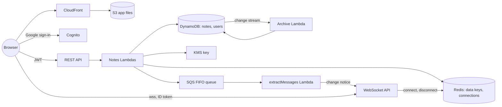

# EncNotes

> This repository publishes the documentation of a private codebase; a script or source
> file the documents name is not here.

A serverless notes app on AWS in which every user's notes are encrypted under a key of their own.
A user signs in with Google and writes Markdown notes in the browser; before a note is stored,
its text is encrypted with that user's data key, which KMS generates once per user and which
only KMS can unwrap. Each change to a note keeps the previous version in an archive, and every
open session of the same account is told about the change at once.

**Contents:** [Overview](#overview) · [Tech stack](#tech-stack) · [Architecture](#architecture) ·
[Getting started](#getting-started) · [Scripts](#scripts) · [Details](#details)

The app runs at [d21uzvmnmnz3ef.cloudfront.net](https://d21uzvmnmnz3ef.cloudfront.net).

## Overview

- **Sign-in**: with a Google account. Each account sees only its own notes.
- **Notes**: a note has a title and a Markdown text. The list shows the notes newest first,
  either rendered as Markdown or as a table.
- **Encryption**: the text of every note is encrypted with a key that belongs to that one
  account before it is stored. The title is stored as written, so it is not secret.
- **Archive**: editing a note keeps the version before the edit in the archive, dated, as a
  read-only copy. Deleting a note moves it to the archive, from which it can be restored.
- **Search**: looks in titles, in texts or both, optionally case-sensitive, and highlights each
  match.
- **Live updates**: when a note is added, edited, deleted or restored, every open session of
  the same account shows a notice and reloads the list.

## Tech stack

- **Backend** — Node.js 24 Lambdas, with the AWS SDK v3, ioredis and jsonwebtoken shipped as
  Lambda layers
- **APIs** — an API Gateway REST API whose requests Cognito authorizes, and an API Gateway
  WebSocket API that pushes change notices to the browser from an SQS FIFO queue
- **Data** — DynamoDB: a notes table that holds the notes and their archived versions, and a
  users table that holds each user's encrypted data key; a Lambda reading the notes table's
  change stream writes the archived versions
- **Encryption** — one KMS key generates a 256-bit data key per user; note texts are sealed with
  AES-256-GCM in Node's `crypto` by an encryption layer kept in its own repository and included
  as a git submodule
- **Cache** — Redis on the account's shared database host, an EC2 instance outside this stack,
  holds the plaintext data keys and each user's open WebSocket connections
- **Frontend** — a React 18 single-page app (Create React App) with Amplify Auth and
  react-markdown, served from S3 behind CloudFront
- **Auth** — a Cognito user pool owned by another stack (`vsdb-cognito`), with Google as the
  only sign-in; this stack adds an app client to it
- **Infrastructure** — one AWS SAM template, deployed by bash scripts to a stack per kind of git
  branch
- **Checks** — `test.sh` runs `bash -n` on every script and `sam validate --lint`; the Lambdas
  have no automated tests

## Architecture

No server runs; each Lambda runs only when a request, a table change or a queued message
triggers it. The browser calls the REST API, whose Lambdas fetch the user's data key (from Redis,
or from the users table through KMS), encrypt or decrypt the note and read or write DynamoDB.
Each write queues a notice for each WebSocket connection the user has open, which one more Lambda
posts to them, and the table's change stream drives a Lambda that writes the archived copies.

**[Architecture](docs/architecture.md)** continues from here: the full diagram, what each
function, queue and table is for, and how a note is encrypted and archived, each with a link to
the document that holds its detail.

## Getting started

You need bash, git, the AWS CLI v2, the AWS SAM CLI, `jq` and Node.js with `npm`.
The stack deploys into an AWS account that already runs the user pool and the database host
of the vpc-subnets-sgs repository ([Setting up Google](docs/sign-in.md#setting-up-google)).

1. `./scripts/init-env.sh` creates the gitignored settings files under `scripts/lib/`; fill
   them in.
2. `./scripts/test.sh` runs every check, with no AWS access.
3. `./scripts/deploy.sh --frontend` deploys the stack and the frontend and prints its address;
   `main` deploys `en`, any other branch `en-fb`.
4. `npm install && npm start` in `frontend/enc-notes/` serves `http://localhost:3000` against the
   branch's stack.

[Development & deployment](docs/development.md) lists every prerequisite and step.

## Scripts

- `init-env.sh` — creates the gitignored settings files under `scripts/lib/` from their
  `.example.sh` files
- `test.sh` — the quality gate: `bash -n` on every script and the SAM lint check
- `deploy.sh` — validates, builds and deploys the branch's stack; `--frontend` also publishes
  the React app, `--frontend-only` only that, `--sync` runs `sam sync` on a feature branch
- `aws-helper.sh` — every other AWS operation on the branch's stack: functions, logs, log
  retention, stack deletion, the region's resources, X-Ray, unused layer versions, and this
  repo's `--apigateway-logging-role`

Each script's header comment is its full documentation, and `--help` prints it.

## Details

- [Architecture](docs/architecture.md) — what each part is for, the storage and the codebase
- [API endpoints](docs/api.md) — each REST and WebSocket route, who may call it, what it answers
- [Workers' responsibilities and flows](docs/workers.md) — what the stream processor and the
  queue's function do, with their limits
- [Domain rules](docs/domain-rules.md) — how a note is encrypted and how it is archived
- [Design patterns](docs/design-patterns.md) — the shared layers, settings, network and CORS
- [Data model](docs/data-model.md) — every table, index, Redis key and the frontend bucket
- [Sign-in](docs/sign-in.md) — how Google sign-in reaches the APIs through the shared pool, and
  its setup in a new account
- [Development & deployment](docs/development.md) — the settings files, the tests, the
  scripts, what the stack expects in the account, and the layers
