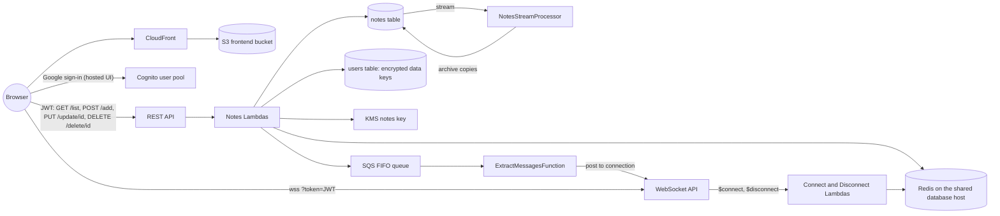

# Architecture

This document details the architecture the [README](../README.md) summarizes: every part
`scripts/template.yaml` deploys, how a note is encrypted and archived, where the data lives and
how the code is laid out. Each section is a summary that links the topic document holding the
detail. How to deploy it is in [Development & deployment](development.md).

**Contents:** [One body of code, several entry points](#one-body-of-code-several-entry-points) ·
[The entry points](#the-entry-points) · [Encryption of a note](#encryption-of-a-note) ·
[The archive](#the-archive) · [Storage](#storage) · [Codebase structure](#codebase-structure)

## One body of code, several entry points

No server runs between requests; a function runs only when a REST call, a WebSocket connect or
disconnect, a change to the notes table or a queued notice triggers it. A REST call wakes one
Node.js function, which gets the caller's data key, encrypts or decrypts a note, reads or writes
DynamoDB, and queues a notice for the caller's open WebSocket connections; a second function
posts those notices. The stack is one SAM template (ADR 0003).

The functions share the encryption code, a CORS helper and their dependencies through Lambda
layers ([Shared code lives in layers](design-patterns.md#shared-code-lives-in-layers)), and each
reads its settings from the stack's parameters
([Settings come from the template and the stack's outputs](design-patterns.md#settings-come-from-the-template-and-the-stacks-outputs)).

## The entry points

Every function writes to a log group the stack declares, `/aws/lambda/<stack>/<logical id>`,
kept for `LogRetentionDays` (14, from `app-env.sh`).

**Entry points**, each route in [API endpoints](api.md):

- **REST API** (`RESTApi`) — four routes, one function each, list, add, update and delete the
  caller's notes behind a Cognito authorizer; each writing function queues a notice for the
  caller's open WebSocket connections.
- **WebSocket API** (`WebSocketApi`) — the connection the notices reach the browser on; the
  connect and disconnect functions keep each user's connection ids in Redis.

**Workers**, each one's steps, limits and retries in
[Workers' responsibilities and flows](workers.md):

- **`NotesStreamProcessor`** — reads the notes table's stream and keeps
  [the archive](#the-archive).
- **`MessagesToWebsocketsQueue`** feeds **`ExtractMessagesFunction`** — the queue carries the
  notices in the order they were sent, and the function posts each one to its connection.

**Hosting and identity**

- **Frontend bucket and CloudFront** — host the React app ([S3](data-model.md#s3)).
- **Cognito** — the user pool is the shared `vsdb-cognito` stack's, with Google as the only
  identity provider; this stack adds an app client ([Sign-in](sign-in.md),
  ADR 0004).

## Encryption of a note

One KMS key, the notes key, wraps one data key per user
(ADR 0001). A function gets the caller's plaintext data key
from Redis, or from KMS on a miss (ADR 0002), and seals
or opens the note's text with it; only the text is encrypted. The steps of the key lookup and
the layout of the stored value are in
[How a note is encrypted](domain-rules.md#how-a-note-is-encrypted).

## The archive

The archive holds the earlier versions of edited notes and the deleted notes, as items of the
notes table marked `archived`. The stream processor writes them: an edit leaves the version
before it as a copy that can be read but not restored, and a deleted note is written back as
archived, from where it can be restored. The exact rules are in
[How a note is archived](domain-rules.md#how-a-note-is-archived).

## Storage

The notes and the data keys live in DynamoDB, and Redis holds the cached data keys and the
WebSocket connection ids. Every table, key, index and bucket is in [Data model](data-model.md).

- **DynamoDB**, the notes table — every note and archive entry, with the stream the archive is
  kept from.
- **DynamoDB**, the users table — each user's data key, wrapped by the notes key.
- **Redis**, on the account's shared database host — each user's plaintext data key and open
  WebSocket connection ids.
- **S3**, the frontend bucket — the React build.

## Codebase structure

- `backend/notes/` — the REST functions (`list/`, `add/`, `update/`, `delete/`), the stream
  processor (`stream/`) and the encryption layer (`layers/encryption/`, a git submodule).
- `backend/websocket/` — `connect/`, `disconnect/` and `extractMessages/`.
- `backend/layers/` — the CORS helper and the dependency layers.
- `frontend/enc-notes/` — the React app: `src/App.js` loads the config and the sign-in,
  `src/components/CrudOperations.js` holds the list, search, editor and WebSocket client, and
  `src/components/MarkdownHighlighting.js` renders notes with search matches highlighted.
- `scripts/` — the SAM template, the API Gateway logging role template and the bash scripts,
  described in [Development & deployment](development.md).
