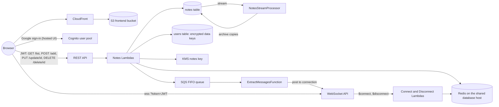

# Architecture

This document details the architecture the [README](../README.md) summarizes: every part
`scripts/template.yaml` deploys, how a note is encrypted and archived, the configuration each
part reads, where the data lives and how the code is laid out. How to deploy it is in
[Development & deployment](development.md).

**Contents:** [One body of code, several entry points](#one-body-of-code-several-entry-points) ·
[The entry points](#the-entry-points) · [Encryption of a note](#encryption-of-a-note) ·
[The archive](#the-archive) · [Cross-cutting mechanisms](#cross-cutting-mechanisms) ·
[Storage](#storage) · [Codebase structure](#codebase-structure)

## One body of code, several entry points

No server runs between requests; a function runs only when a REST call, a WebSocket connect or
disconnect, a change to the notes table or a queued notice triggers it. A REST call wakes one
Node.js function, which gets the caller's data key, encrypts or decrypts a note, reads or writes
DynamoDB, and queues a notice for the caller's open WebSocket connections; a second function
posts those notices. The stack is one SAM template (ADR 0003).

## The entry points

- **Frontend bucket and CloudFront** — the React build lives in an S3 bucket with website
  hosting and public read access (`S3PublicAccess=true` in `stack-params.sh`). CloudFront reaches
  it through the bucket's website endpoint over HTTP and redirects viewers to HTTPS. The app
  fetches `appConfig.json` from the same origin at startup for its API URLs and Cognito ids.
- **Cognito** — the user pool and its domain belong to another stack and reach this one as the
  `ExistingUserPoolId` and `ExistingCognitoDomain` parameters. The stack creates only an app
  client, with the authorization-code flow, Google as its only identity provider, and the
  CloudFront address and `http://localhost:3000` as its sign-in and sign-out URLs. The browser
  signs in with Amplify's redirect to Google through Cognito and sends the ID token as a bearer
  token (ADR 0004).
  [Sign-in](sign-in.md) details the flow and its setup in a new account.
- **REST API** (`RESTApi`) — its Cognito authorizer checks the token on every route. The stage is
  `prod` for the `en` stack and `dev` for `en-fb`. The routes, one function each, under
  `backend/notes/`:
  - `GET /list` (`ListNotesFunction`) — queries the caller's notes by the `UserIdUpdatedIndex`
    index, newest first, in one query with no paging, and decrypts each text. With a
    `searchTerm` it filters the decrypted notes in the function by title, text or both,
    optionally case-sensitive. It returns archived notes too; the browser splits active from
    archived.
  - `POST /add` (`AddNoteFunction`) — stores a note under a new random id, its text encrypted.
  - `PUT /update/{id}` (`UpdateNoteFunction`) — a body with a title replaces the title and the
    re-encrypted text; a body without one sets `archived`, which is how a note is restored.
  - `DELETE /delete/{id}` (`DeleteNoteFunction`) — deletes the item; the stream processor puts
    it back as archived.

  After its write, each writing function (add, update, delete) reads the caller's connection ids
  from Redis and queues one notice per connection.
- **NotesStreamProcessor** (`backend/notes/stream/`) — reads the notes table's stream, which
  carries each item's image before the change, and keeps the archive (below).
- **WebSocket API** (`WebSocketApi`) — the browser connects with its ID token in the `token` query
  parameter. `ConnectFunction` (`backend/websocket/connect/`) reads the user id from the token's
  `sub` claim and records the connection in Redis; `DisconnectFunction` removes it. No other route
  exists. The stage writes access logs to a log group of the stack and needs the account's API
  Gateway logging role, which `aws-helper.sh --apigateway-logging-role` sets up once
  (`scripts/apigateway-logging-role.yaml`).
- **SQS queue** (`MessagesToWebsocketsQueue`) — a FIFO queue with content-based deduplication;
  every notice goes to one message group, so notices are delivered in the order they were sent.
  A notice is the connection id, a `refresh` command and a line of text naming the note.
- **ExtractMessagesFunction** (`backend/websocket/extractMessages/`) — triggered by the queue in
  batches of up to 10, posts each notice to its connection through the API Gateway management
  API. A connection that has gone is logged and left in Redis.
- **Layers** — `CorsHeadersLayer` (`backend/layers/corsHeaders/`), the AWS SDK v3, ioredis and
  jsonwebtoken layers (zips in `backend/layers/`, built from the `nodejs/` folders beside them),
  and `NotesEncryptionLayer`, the git submodule at `backend/notes/layers/encryption/`. Lambda
  mounts them under `/opt/`.

## Encryption of a note

One KMS key, the notes key, wraps one data key per user
(ADR 0001). `getUserDataKey` in the encryption layer returns
the caller's plaintext data key:

1. It reads `DEK(<user id>)` from Redis and returns the key on a hit
   (ADR 0002).
2. On a miss it reads the user's item from the users table and asks KMS to decrypt its
   `encryptedDEK`, then writes the plaintext key to Redis.
3. A user with no item gets a new 256-bit key from KMS `GenerateDataKey`; the plaintext goes to
   Redis and the encrypted copy to the users table.

With `ExistingRedisAddress` empty, the layer skips Redis and asks KMS on every call. The
`EnableUserDataKeysCache` parameter is declared but read by nothing; the Redis address alone
decides. Redis stays required all the same: the writing functions and the WebSocket
functions connect to it unconditionally for the connection ids.

The text is sealed with AES-256-GCM under a random 12-byte IV and stored as one binary value:
the IV, the ciphertext, then the 16-byte authentication tag. The title, ids and timestamps are
stored in plaintext.

## The archive

The stream processor turns every change into archive entries in the same table:

- **Edit** — when a note that is not archived changes, the version before the change is written
  as a new item with the id `<id>-<old updatedAt>`, its title suffixed with the old date, marked
  `archived` and `unrestorable`. It can be read but not restored.
- **Delete** — a deleted note that was not archived is written back as `archived`, so it moves to
  the archive. Restoring it sets `archived` to false through `PUT /update/{id}`.

A change to an archived item creates no copy. The browser offers no delete for an archived note,
so the archive only grows.

## Cross-cutting mechanisms

- **Configuration.** `scripts/lib/stack-params.sh` holds every parameter the stack is deployed
  with, the Redis password excepted, which comes from the gitignored `scripts/lib/secrets.sh`.
  The template passes them to the functions as environment variables: the table names, the KMS
  key id, `REDIS_ADDRESS`, `REDIS_PASSWORD`, the queue URL and `ALLOWED_ORIGIN`. The browser
  reads the stack's outputs from `appConfig.json`, which `lib/app-config.sh` writes.
- **Shared resources.** The notes and users tables and the notes key belong to no stack:
  `stack-params.sh` passes their names to both branch stacks, so both read and write the same
  notes. The template can create each of them instead, when its parameter is empty.
- **Redis.** Redis runs on the account's shared database host, an EC2 instance outside this stack,
  reached with a password. The networking parameters of the template are left empty, so the
  functions run outside any VPC.
- **CORS.** The functions answer with the origin of `ALLOWED_ORIGIN`: the CloudFront address on
  the `en` stack, any origin on `en-fb`. The REST API's own preflight and error responses allow
  any origin.
- **Logs.** Every function writes to a log group the stack declares,
  `/aws/lambda/<stack>/<logical id>`, kept for `LogRetentionDays` (14, from `app-env.sh`).

## Storage

| Store | Key | Contents |
| --- | --- | --- |
| notes table | `id` | `userId`, `title`, `content` (binary), `createdAt`, `updatedAt`, optional `archived` and `unrestorable`; index `UserIdUpdatedIndex` on `userId` and `updatedAt`; stream of old images; point-in-time recovery |
| users table | `userId` | `encryptedDEK` (binary), the user's data key wrapped by the notes key |
| Redis `DEK(<user id>)` | string | the user's plaintext data key, with no expiry |
| Redis `connections(<user id>)` | set | the user's open WebSocket connection ids |
| Redis `userId(<connection id>)` | string | the user a connection belongs to |

Both tables bill per request. A table or key the stack creates is kept when the stack is
deleted.

## Codebase structure

- `backend/notes/` — the REST functions (`list/`, `add/`, `update/`, `delete/`), the stream
  processor (`stream/`) and the encryption layer (`layers/encryption/`, a git submodule).
- `backend/websocket/` — `connect/`, `disconnect/` and `extractMessages/`.
- `backend/layers/` — the CORS helper and the dependency layers.
- `frontend/enc-notes/` — the React app: `src/App.js` loads the config and the sign-in,
  `src/components/CrudOperations.js` holds the list, search, editor and WebSocket client, and
  `src/components/MarkdownHighlighting.js` renders notes with search matches highlighted.
- `scripts/` — the SAM template, the API Gateway logging role template and the bash scripts,
  described in [Development & deployment](development.md).
